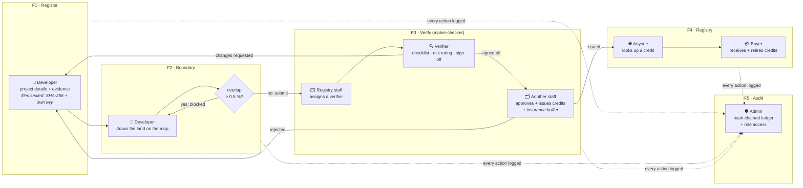
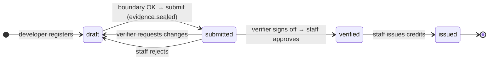
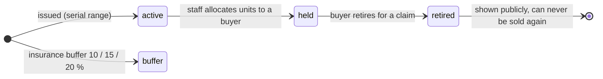

# 1 · Feature workflow

[← Diagrams](README.md)

## Who does what

## Status of a project

## Life of a credit

**Rules that make it trustworthy**

| | Rule |
|---|---|
| F1 | Evidence is write-once: a DB trigger blocks edits; personal data erased by destroying the file's key |
| F2 | Same land can't earn twice: PostGIS checks every boundary against all others |
| F3 | No one creates credits alone: verifier ≠ approver ≠ project owner |
| F4 | Retired units are locked; the public sees the claim, not the buyer's name |
| F5 | Each ledger entry stores the hash of the previous one: change one and the chain breaks |
