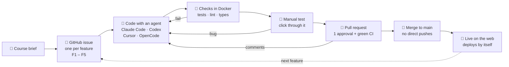
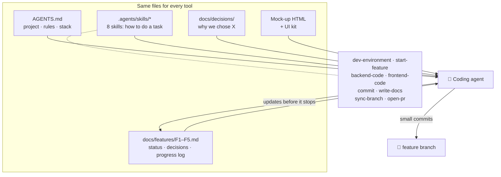
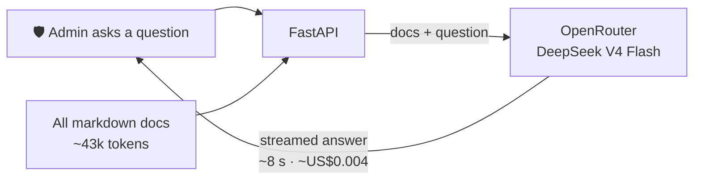

# 2 · How we use AI

[← Diagrams](README.md)

**AI agents write the code. People decide what to build, test it and review it.**

## The loop, per feature

## Where the agent gets its context

**Why it works:** the feature doc is the hand-over note. Any agent or teammate picks up where the
last session stopped.

## AI inside the app: System › Assistant

No vector DB, nothing stored: the chat lives only in the browser tab.

| | |
|---|---|
| Issues | 31 |
| Merged pull requests | 51 |
| Skills | 8 |
