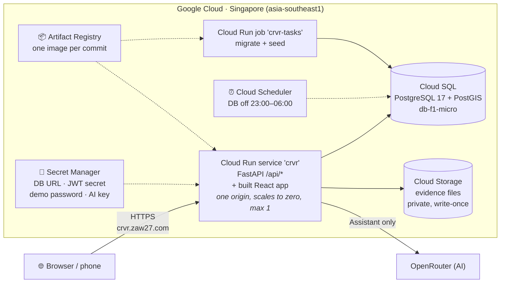

# 3 · Cloud architecture

[← Diagrams](README.md)

| Choice | Why |
|---|---|
| One service for API + frontend | same origin → httpOnly cookie, no CORS, one cold start |
| Scale to zero, DB off at night | ≈ ฿300–370 / month, budget alert at ฿500 |
| Domain mapping, no load balancer | free (a load balancer is ~US$18 / month) |
| Evidence in Cloud Storage API | atomic write-once (a mounted folder can't guarantee it) |

Details: [deployment.md](../deployment.md) · [ADR 0008](../decisions/0008-cloud-run-class-demo.md).
