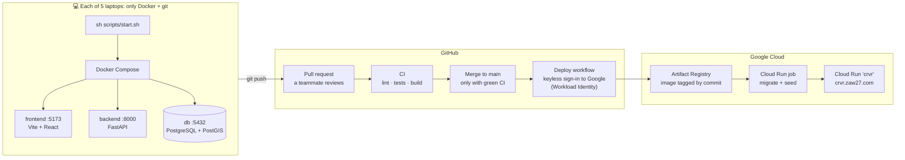
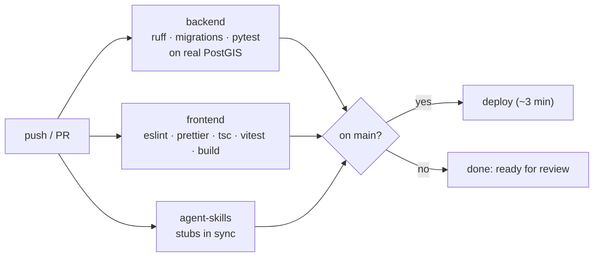

# 4 · Infrastructure & delivery

[← Diagrams](README.md)

## From laptop to cloud

## What CI checks

## Ops buttons (GitHub Actions)

| Workflow | Does |
|---|---|
| `ci.yml` → `deploy.yml` | every merge to `main` goes live |
| `demo-power.yml` | database on / off / hold (e.g. grading week) |
| `reset-demo.yml` | wipe and reseed demo data before a presentation |
