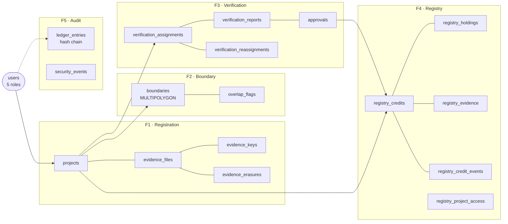
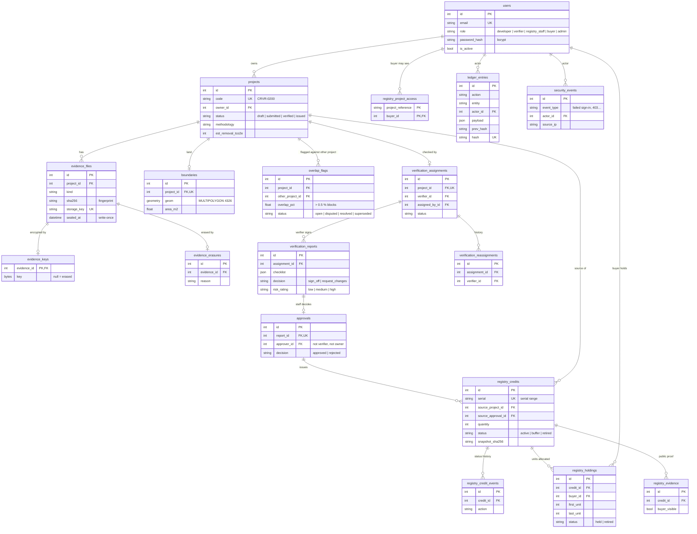

# 5 · Database design

[← Diagrams](README.md)

PostgreSQL 17 + PostGIS · 18 tables · one schema, tables grouped by the feature that owns them.

## Overview

## Entity–relationship

| Guard | Where |
|---|---|
| Evidence can't be changed | DB trigger on `evidence_files` |
| Ledger can't be edited | DB trigger + `prev_hash → hash` chain |
| Erasure log is append-only | DB trigger on `evidence_erasures` |
| Retired units are locked | DB trigger on `registry_holdings` |
| One boundary / one assignment per project | `UNIQUE (project_id)` |
| Overlap measured in the DB | PostGIS `ST_Intersection` / `ST_Area` on `boundaries.geom` |
